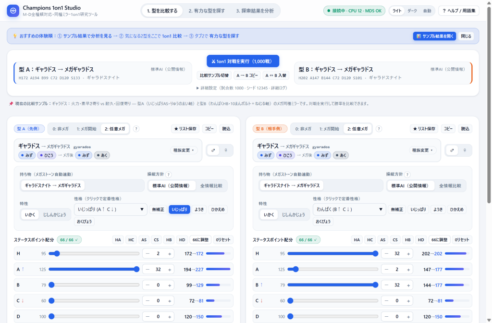
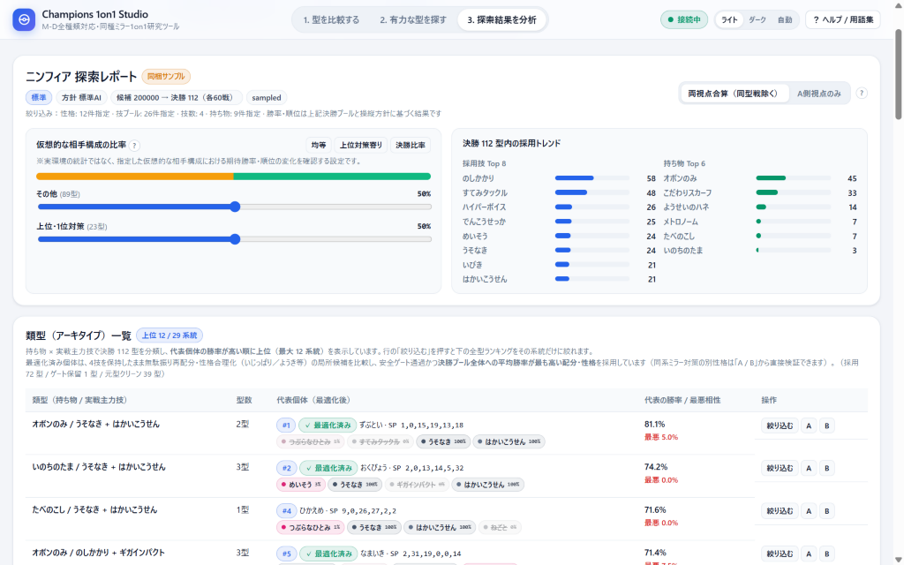

# Champions 1on1 Simulator

> **同じポケモン同士で戦ったら、どんな型が強いのか？**  
> 技・持ち物・性格・ステータスポイントの組み合わせから有力な型を探索し、大量の 1on1 対戦で比較する研究ツールです。  
> 平均勝率だけでなく、苦手な型、1 位への対策型、三すくみの関係まで分析できます。

単一の「絶対的な最強の型」を断定するのではなく、**相手集団・操縦方針・探索条件によって有力な型どうしの力関係がどう変わるか**を定量的に検証・可視化することを目的としています。

---

## できること

1. **2 つの型を直接比較する（型 A vs 型 B）**  
   技・持ち物・性格・ステータスポイント（合計 66）・メガシンカ区分を自由に編集し、同種ミラー 1on1 を数百〜数万試合シミュレーションして勝率差を確認できます。
2. **広い候補空間から有力な型を探索する**  
   「物理アタッカー」「耐久型」といった役割の先入観で候補を足切りせず、段階的スクリーニングと決勝総当たりで有力候補を絞り込みます（探索規模・条件絞り込み対応）。
3. **強さと相性関係を分析・可視化する**  
   決勝プール内の平均勝率・最低勝率（最悪相性）・総当たり勝率ヒートマップ・1 位対策型・仮想的な相手構成スライダーにより、相性構造と順位変動をブラウザ上で確認できます。

---

## 画面イメージと実データによる分析例

### 1. 型を比較する画面（2 型サンプルの初期状態）



### 2. 探索結果を分析する画面



### 実測サンプルから分かること（`viewer/examples/sylveon-standard`）

既定の同梱サンプル（種族: ニンフィア／標準探索: 候補 200,000 → 決勝 112 型・各ペア 240 戦／条件付きサンプリング／標準 AI 操縦 `obsh4`）に対し、実戦の技使用率計測と安全ゲート付き局所最適化（4 技保持・採用 72 型／ゲート保留 1 型／元型クリーン 39 型）＋最適化後 112 型総当たり（各ペア 60 戦・両視点合算・同型戦除く）を行った結果、上位の代表類型は次の通りになりました。

| 類型（持ち物 / 実戦主力技） | 系統内型数 | 代表個体（最適化後） | 新決勝平均勝率 | 決勝内最低勝率（最悪相性） |
|---|---:|---|---:|---:|
| **オボンのみ / うそなき + はかいこうせん** | 2 型 | `#92`（1 位・最適化済み）ずぶとい `1,0,15,19,13,18`（つぶらなひとみ入り） | **81.1%** | 5.0% |
| **いのちのたま / うそなき + はかいこうせん** | 3 型 | `#23`（2 位・最適化済み）おくびょう `2,0,13,14,5,32` | **74.2%** | 0.0% |
| **たべのこし / うそなき + はかいこうせん** | 1 型 | `#60`（4 位・元型クリーン）ひかえめ `9,0,26,27,2,2` | **71.6%** | 0.0% |
| **オボンのみ / のしかかり + ギガインパクト** | 3 型 | `#83`（5 位・最適化済み）なまいき `2,31,19,0,0,14` | **71.4%** | 7.5% |
| **こだわりスカーフ / すてみタックル** | 16 型 | `#4`（6 位・最適化済み）いじっぱり `12,32,1,0,2,19` | **70.8%** | 2.5% |
| **こだわりスカーフ / のしかかり** | 17 型 | `#46`（8 位・最適化済み）いじっぱり `14,32,6,0,1,13` | **69.1%** | **14.2%** |

この結果からは、**高速特殊（珠・ハネ）→ スカーフ物理（すてみタックル・のしかかり）に上から縛られる → B 振りオボン＋つぶらなひとみ特殊（1 位 `#92`）がスカーフ物理を受けて返す → 1 位はより D の高い特殊珠型に弱い**、という 1on1 特有の三すくみ構造が見えます。また、実戦で 1% 未満しか使われない技は薄く表示され、最適化前後の差分（Before / After）もページ下部で検証できます。

> ※上記は同梱サンプル（[viewer/examples/README.md](viewer/examples/README.md) に条件・シード・最適化パス設定を記載）の決勝プール内での実測値であり、全組み合わせに対する普遍的な最強型を示すものではありません。従来の `gyarados-light` サンプルも同ディレクトリに併録しています。

---

## まず試す（インストール不要・最短）

ダウンロード直後にローカルサーバを起動しなくても、同梱サンプルを使って分析画面を体験できます。

1. [viewer/index.html](viewer/index.html) をブラウザで直接開く（ダブルクリック等）
2. 画面上部の **「📊 サンプル結果を開く」** をクリック

ランキング・勝率ヒートマップ・注目候補ピック・仮想構成スライダー・型編集（Lv.50 実数値計算）はサーバ不要でそのまま動作します。

---

## インストール・動作要件・起動方法

1on1 対戦シミュレーションの実行や、任意の種族での新規探索には **Python 3**（標準ライブラリのみ・追加パッケージ不要）と **C コンパイラ（`gcc`）** が必要です。

### OS 別の最短起動方法

| OS | 必要なもの | 最短起動コマンド / 補助スクリプト |
|---|---|---|
| **Windows** | Python 3 + GCC（WinLibs / MSYS2 等） | [start_workbench.bat](start_workbench.bat) をダブルクリック、または `py -3 viewer/server.py` |
| **macOS** | Python 3 + Command Line Tools (`xcode-select --install`) | `./start_workbench.sh` または `python3 viewer/server.py` |
| **Linux** | Python 3 + `build-essential` (`gcc`) | `./start_workbench.sh` または `python3 viewer/server.py` |

- 起動すると既定で `http://127.0.0.1:8765/` が開きます（終了はターミナルで `Ctrl+C`）。
- 現在のリポジトリ上で起動補助スクリプトの実行を確認済みなのは **Windows（`start_workbench.bat`）** です。[start_workbench.sh](start_workbench.sh) は macOS / Linux 向けの軽量ラッパーとして同梱しています（必要に応じて `chmod +x start_workbench.sh` の後に実行してください）。
- 性能目安：標準 AI 同士のシミュレーションは、CPU 並列（Core i5-12400・10 並列測定時）で約 8,000〜10,000 試合/秒で動作します。

---

## 対応範囲と制約

本ツールを正しく解釈するための前提と制約です。

- **対応種族・形態**：**259 種族（メガシンカを含む 341 形態）**、511 技＋わるあがき、217 特性、通常持ち物 85 種＋メガストーン 81 種、Lv.50・ステータスポイント合計 66。対象は**同種ミラー 1on1 のみ**です（異種対戦・3on3・ダブルバトルは対象外）。
- **操縦 AI と強化学習の適用範囲**：
  - 全種族の標準探索・比較で使われる操縦役は、対戦中に公開される情報だけを参照する**近似的な標準ヒューリスティクス（`obsh4`・観測 v3）**です。万能な最適プレイ AI ではなく、勝率・順位は操縦方針に依存します。
  - 同梱の PPO 強化学習パイプライン（[training/](training/README.md)）は **17 技メタグロス（観測 v1）専用** です。全種族を強化学習 AI で操縦しているわけではありません。
- **探索空間と除外規約**：全組み合わせの完全網羅ではなく、探索上の除外規約（性格下降補正の無駄ポイントや均等配分等）とサンプリング／段階的スクリーニングを用いています。
- **再現性と実機仕様の違い**：
  - 両者の技選択は同時処理し、乱数は試合インデックスから決定的に生成しています。
  - 検証マトリクスの MD5 一致は**エンジン改変に対する回帰確認**であり、実機との完全一致を保証するものではありません。
  - てっていこうせん等の自爆系両倒れは「使用者の負け」と扱うなど、既知の独自規約があります（詳細は [docs/known_issues.md](docs/known_issues.md)）。
- **仮想的な相手構成スライダー**：結果分析タブのスライダーは、現実の使用率統計やランク帯データではなく「指定した仮想的な相手構成における期待勝率」を見るための機能です。

---

## 開発者向け詳細・CLI・ドキュメント

### エンジンのビルドと回帰検証

```sh
# Linux / macOS / Windows 共通（Python hashlib 利用・md5sum 不要）
python3 engine/verify_matrix.py --build

# make が使える環境
make verify
./engine/engine policy-version
```

観測 OFF および互換観測 ON（`ENGINE_OBSERVER=1 ENGINE_OBS_COMPAT=1`）で `matrix 3000 12345` の出力 MD5 が `f3128c506954574a0c48bdfb79e2a917` と一致すれば回帰チェックは正常です。

### CLI からの種族探索

```sh
python3 search/search_tiers.py gen gyarados light runs/gyarados-light
python3 search/search_controller.py runs/gyarados-light
```

### リポジトリ構成と詳細ドキュメント

| パス | 役割・内容 |
|---|---|
| [viewer/](viewer/index.html) | 259 種族（メガ含む 341 形態）対応 HTML ワークベンチ（[viewer/server.py](viewer/server.py)、同梱サンプル [viewer/examples/](viewer/examples/README.md)） |
| [engine/](engine/engine.c) | 単一 C ファイルの高速対戦エンジン（`-lm` のみ依存）。`stage3/`・`campaign3/` に重み、`stage8/` に種族・技・特性テーブル、[verify_matrix.py](engine/verify_matrix.py) にクロスプラットフォーム検証を収録 |
| [search/](search/README.md) | 規模選択・条件絞り込みつき型探索ツール（[search_tiers.py](search/search_tiers.py) / [search_controller.py](search/search_controller.py) / [population3.py](search/population3.py)） |
| [data/](data/species_dataset.json) | データセット（[species_dataset.json](data/species_dataset.json)：341 形態・512 技・PP 上限 20 準拠、[type_chart.json](data/type_chart.json)：18×18 タイプ相性表） |
| [docs/](docs/spec_and_cli.md) | 型スペック文法・CLI（[spec_and_cli.md](docs/spec_and_cli.md)）、観測仕様 v3（[observation_spec_v3.md](docs/observation_spec_v3.md)）、既知仕様・評価規約（[known_issues.md](docs/known_issues.md)）、過去の仕様・知見記録（[docs/archive/](docs/archive/)） |
| [training/](training/README.md) | PPO 強化学習パイプライン（v1 / `MGO1`・17 技メタグロス専用。Colab GPU ガイドは [training/colab/README.md](training/colab/README.md)） |
| [skill/](skill/SKILL.md) | 1on1 型探索の汎用分析手順 |
| [AGENTS.md](AGENTS.md) | AI エージェント向け作業ルール・検証規約 |

---

## 出典・権利・ライセンス

- 本プロジェクトは非公式のファンプロジェクトであり、任天堂・株式会社ポケモン・ゲームフリークとは関係がありません。ポケモンおよび関連名称・データの権利は各権利者に帰属します。
- 技・種族などのデータは Pokémon Showdown（MIT ライセンス）の champions mod、Serebii、PokeAPI を出典として突き合わせています。
- コード部分のライセンスは [LICENSE](LICENSE) を参照してください（データ部分は出典側の権利に従います）。
